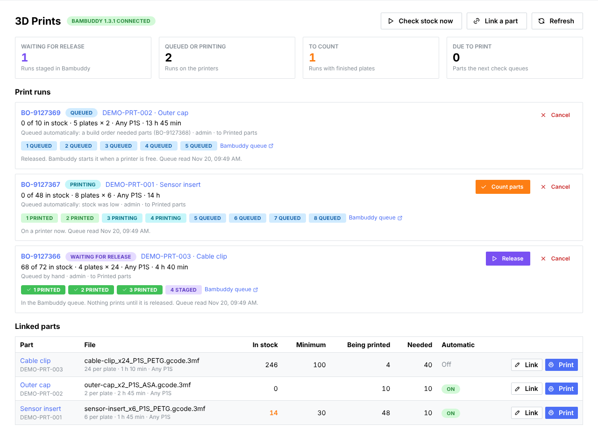
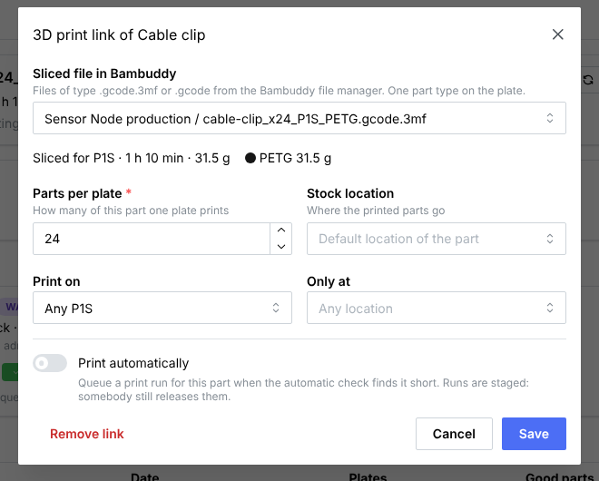
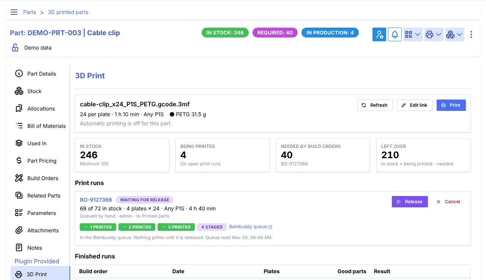

# InvenTree Bambuddy

Print 3D printed parts from [InvenTree](https://inventree.org) through
[Bambuddy](https://github.com/maziggy/bambuddy), the self-hosted print manager
for Bambu Lab printers.

- Link a part to its sliced file in Bambuddy and say how many are on a plate.
- Press **Print** on the part page. The plugin raises a build order and adds
  the plates to the Bambuddy queue, staged: nothing starts until somebody
  releases it.
- When the plates have printed, count the good parts. They are booked into
  stock against the build order.
- Optionally, let the plugin queue the prints itself: when stock falls below
  the minimum, or when a build order in production needs more than there is.

Built and tested against InvenTree 1.7.3 and Bambuddy 1.3.1.

## How it works

### The link

The sliced file stays in Bambuddy. The part only stores which file it is:

| | |
|---|---|
| File | A `.gcode.3mf` or `.gcode` file in Bambuddy's file manager, and the plate if the file has several |
| Parts per plate | How many of the part one plate prints. One part type per plate |
| Print on | Any printer of the model the file was sliced for (optionally at one location), or one specific printer |
| Stock location | Where the printed parts go. Default: the default location of the part |
| Print automatically | Whether the automatic check may queue this part |
| Print up to | The level to print up to when stock is low. Default: the minimum stock |
| Most plates at once | Limit for one automatic run. Default: from the plugin settings |

The link is stored in the metadata of the part, under the key `bambuddy`.
InvenTree only raises build orders for assemblies, so linking a part marks it
as an assembly.

If a file is sliced again, upload the new file to Bambuddy and point the link
at it. A link to a file which has been deleted is refused when printing, with
a message saying so.

### A print run

A print run is a build order for the printed part, plus one item in the
Bambuddy queue for each plate.

| State | Meaning | What you do |
|---|---|---|
| Waiting for release | Staged in Bambuddy ("Queue Only") | **Release**, here or with Play in Bambuddy |
| Queued | Released, waiting for a printer | Load filament, clear the plate: as Bambuddy asks |
| Printing | On a printer | |
| Count the parts | One or more plates have finished | **Count parts**: enter the good parts |
| Short | Counted, fewer than the build order asked for | **Print the shortfall** or **Close short** |
| Nothing printed | Every plate failed or was removed | **Print again** or **Cancel** |
| Done | Build order complete, parts in stock | |

Things to know:

- The build order is for whole plates: 10 parts at 4 a plate is 3 plates and a
  build order for 12.
- The build order is in production from the moment it is queued, so the
  quantity still to come shows as "in production" on the part, and counts as
  incoming for anything which plans from build orders.
- Counting creates a build output for the good parts and completes it into
  stock. Plates can be counted while others are still printing. Once nothing
  is left in the queue and the quantity is reached, the build order completes.
- Cancelling takes the plates which have not started out of the Bambuddy
  queue. A plate which is printing is left to finish. Cancelling the build
  order in InvenTree does the same.
- In Bambuddy the plates are one batch, named after the build order and tagged
  with its reference (`external_source` `inventree`).

### Automatic printing

Both triggers use one sum for each linked part:

    left over = in stock + still to come from open build orders
                - still needed by build orders in production

A run is queued when that is below the floor: the minimum stock of the part
if "Print when stock is low" is on, otherwise zero. It prints up to the
"Print up to" level of the link (or the floor), rounded up to whole plates.

- **Print when stock is low** uses the minimum stock of the part.
- **Print when a build order needs parts** takes the requirements of build
  orders in production into the sum. It runs the moment a build order is
  issued. Requirements come from the build lines, so the printed part has to
  be on the BOM of what is being built.
- The check also runs every 10 minutes, and from **Check stock now** on the
  3D Prints page.
- Open print runs count as "still to come", so a shortage is queued once.
- Automatic runs are staged like any other. Nothing prints until it is
  released.
- A run queued for a build order is a child of that build order.

Both triggers are off until switched on in the plugin settings, and apply only
to parts with "Print automatically" on.

## Installation

### 1. Install the plugin

In the InvenTree web interface: *Admin Center → Plugins → Install Plugin*, with

- Package name: `inventree-bambuddy`
- Source URL: `git+https://github.com/nemccarthy/inventree-bambuddy@main`

Or add this line to `plugins.txt` in the InvenTree data directory:

    inventree-bambuddy @ git+https://github.com/nemccarthy/inventree-bambuddy@main

### 2. Switch on what it needs

In *Admin Center → Plugins → Plugin Settings*:

- **Enable URL integration**: the plugin's API
- **Enable interface integration**: the panel and the page
- **Enable schedule integration**: following the print queue in the background
- **Enable event integration**: printing when a build order is issued, and
  clearing the queue when a print run's build order is cancelled
- **Check plugins on startup** (Docker)

Then activate **Bambuddy** in the plugin list.

### 3. Update and restart (Docker)

From the directory with the InvenTree compose file:

    docker compose run --rm inventree-server invoke update
    docker compose restart inventree-server inventree-worker

This installs the plugin in the worker as well as the server, and copies the
compiled frontend into InvenTree's static files. Repeat it after every update
of the plugin. Without it the page shows "Failed to load module".

### 4. Connect Bambuddy

The **InvenTree server and worker** talk to Bambuddy, not the browser. When
InvenTree runs in Docker, `localhost` inside its containers is the container
itself, even if Bambuddy runs on the same machine.

Bambuddy's own compose file uses host networking, so it listens on port 8000
of the machine. To reach that from the InvenTree containers, add this to both
the `inventree-server` and the `inventree-worker` service in the InvenTree
compose file:

    extra_hosts:
      - "host.docker.internal:host-gateway"

and use `http://host.docker.internal:8000` as the address. The LAN address of
the machine (`http://192.168.x.x:8000`) works too, without changing the
compose file. A firewall on the machine has to allow port 8000 from the Docker
network.

Once the address is saved, the 3D Prints page shows "Bambuddy connected" with
its version, or the reason it could not be reached.

If Bambuddy has authentication on, create a key under *Settings → API Keys*
in Bambuddy with permission to read status and to queue prints. Nothing else
is needed.

### 5. Plugin settings

| Setting | Default | |
|---|---|---|
| Bambuddy address | | As reached from the InvenTree server and worker |
| Bambuddy API key | | Empty if Bambuddy runs without authentication |
| Bambuddy address for links | | As opened in a browser. Adds a link to the Bambuddy queue on each run |
| Print when stock is low | off | |
| Print when a build order needs parts | off | |
| Count pending build orders | off | Also count build orders which have not been issued |
| Most plates to queue automatically | 10 | For one automatic run, unless set on the link |
| Days until printed parts are in stock | 1 | Target date of the build order |
| Stock location for printed parts | | Used when neither the link nor the part has one |
| Show in the navigation bar | on | |
| Show on part pages | on | |
| Only on linked parts | off | Hide the panel on parts without a link |

The 3D Prints page shows whether Bambuddy is reachable, and warns when the
background integrations are off.

## Permissions

| To | A user needs |
|---|---|
| See the panel and the page | *view* on Part |
| Link a part, or change a link | *change* on Part |
| Queue a print run, or start the automatic check | *add* on Build Orders |
| Release, count, reprint, close or cancel a run | *change* on Build Orders |

## API

Served below `/plugin/bambuddy/`, with session or token authentication.

| | |
|---|---|
| `GET config/` | Settings, permissions, state of Bambuddy and its printers |
| `GET overview/` | Every linked part and every open run |
| `GET files/` | Sliced files in Bambuddy's library |
| `GET files/<id>/` | One file with its plates |
| `GET part/<id>/` | Link, stock figures and runs of a part |
| `PUT part/<id>/` | Link the part: `{"file_id": 12, "parts_per_plate": 4, "auto": true, "restock_to": 40}` |
| `DELETE part/<id>/` | Remove the link |
| `POST part/<id>/print/` | Queue a run: `{"plates": 3}` or `{"quantity": 10}` |
| `GET run/<build id>/` | One run, with the queue freshly read |
| `POST run/<build id>/release/` | Release the staged plates |
| `POST run/<build id>/confirm/` | Book good parts: `{"good": 11, "location": 7}` |
| `POST run/<build id>/reprint/` | Queue more plates: `{"plates": 1}` |
| `POST run/<build id>/close/` | Complete the build order as it stands |
| `POST run/<build id>/cancel/` | Cancel the run |
| `POST check/` | Run the automatic check. `{"dry_run": true}` only reports |

    curl -X POST "$INVENTREE_URL/plugin/bambuddy/part/42/print/" \
      -H "Authorization: Token $INVENTREE_TOKEN" -H "Content-Type: application/json" \
      -d '{"quantity": 10}'

## Limits

- One part type per plate. A plate with different parts on it cannot be linked.
- One file per part. Printing the same part on two printer models needs two
  parts, or a change of link.
- Parts tracked by serial number cannot be linked.
- Demand is read from build orders only, for the exact part: sales orders,
  variants and BOM substitutes are not counted.
- The plugin does not choose filament. Bambuddy matches what is loaded when
  the plate starts. If it refuses to release a plate because the loaded spool
  is short, the plugin shows the message and offers "Release anyway".
- A plate which finishes printing still counts as printed if the parts are
  bad: the good count is what you enter.
- Filament is not consumed in InvenTree unless the part has a BOM with
  filament on it and stock is allocated to the build order.
- Bambuddy 1.2.5.7 or later tags the batch with the build order reference.
  Older versions still queue, without the tag.
- The queue is read every 2 minutes in the background, and whenever a page
  showing a run is open.

## Development

    cd frontend
    npm ci
    npm run build        # writes inventree_bambuddy/static/

The compiled frontend is committed, so the plugin installs straight from git.
CI fails if it does not match the source.

    python -m pip install pytest requests
    python -m pytest tests

`tests/` covers the rules (plates, when to print, the state of a run) in plain
Python. `dev/integration_check.py` runs the whole flow against a live InvenTree
and a live Bambuddy, for a throwaway setup only: it marks queue items as
printed by writing to Bambuddy's database. `dev/seed_demo.py` fills such a
setup with made-up data, and `dev/make_sliced_3mf.py` writes stand-in sliced
files.

To release: bump `PLUGIN_VERSION` in `inventree_bambuddy/__init__.py` and
`version` in `frontend/package.json`, update `CHANGELOG.md`, then push a tag
`vX.Y.Z`.

## Licence

MIT
